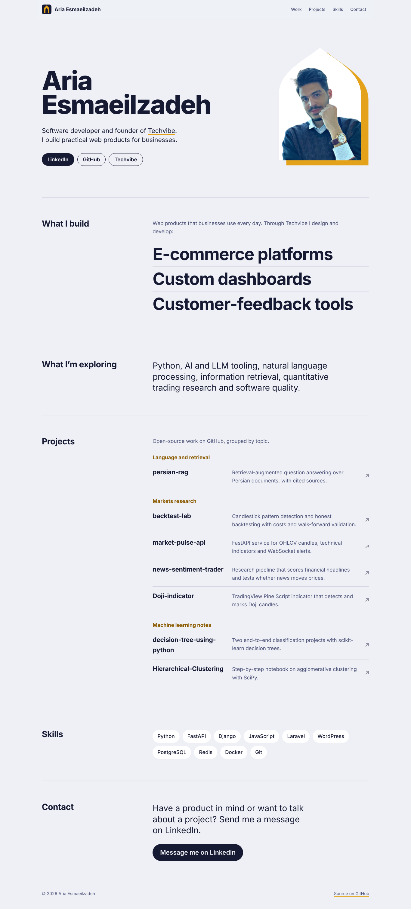
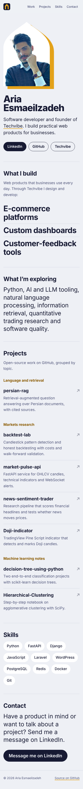
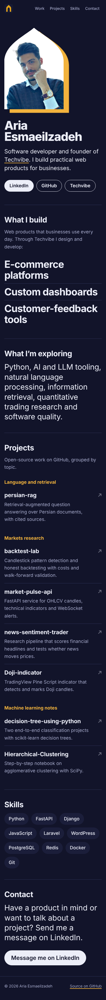

# ariaesm.github.io

Personal website of **Aria Esmaeilzadeh**, software developer and founder of
[Techvibe](https://techvibe.ir). Live at <https://ariaesm.github.io/>.



## What's inside

A single hand-written page with no framework, no build step and no third-party scripts:

| File | Purpose |
| --- | --- |
| `index.html` | Content, meta tags, Open Graph and JSON-LD `Person` data |
| `style.css` | Layout, type scale, light and dark themes (`prefers-color-scheme`) |
| `script.js` | Highlights the current section in the navigation (about 30 lines) |
| `img/favicon.svg` | SVG favicon (arch monogram) |
| `img/og-image.png` | 1200×630 social preview image |
| `img/user-photo-sq.jpg` | Portrait |

Design notes:

- Typeface: [Bricolage Grotesque](https://fonts.google.com/specimen/Bricolage+Grotesque)
  (Google Fonts, SIL Open Font License) with a system-font fallback.
- The portrait sits in a pointed arch drawn as an inline SVG clip path; the saffron arch
  behind it is the only animation on the page and is disabled with `prefers-reduced-motion`.
- Accessibility: skip link, semantic landmarks and headings, visible focus outlines,
  sufficient colour contrast in both themes, no information conveyed by colour alone.
- Responsive from 320 px upward without horizontal scrolling.
- Contact is via LinkedIn; the page shows no phone number, address or plain-text email.

| Mobile (light) | Mobile (dark) |
| --- | --- |
|  |  |

## Local preview

```bash
python3 -m http.server 8000
# open http://localhost:8000/
```

GitHub Pages serves the `main` branch as-is (`.nojekyll` skips Jekyll processing).

## History

Earlier versions of this site were built on a commercial HTML template. It was replaced in
2026 with this original, hand-built page; the old files remain only in Git history.
